# Manual

Everything AutoSplit-rs does, to look things up. For setting it up the first time, follow [TUTORIAL.md](TUTORIAL.md) instead.

- [The main window](#the-main-window)
- [Make Split Images](#make-split-images)
- [Editing presets](#editing-presets)
- [Live Tester](#live-tester)
- [Settings](#settings)
- [Split image file names](#split-image-file-names)
- [Profiles](#profiles)
- [Timers](#timers)
- [Keyboard shortcuts](#keyboard-shortcuts)
- [Permissions](#permissions)
- [Linux](#linux)
- [Command line](#command-line)

## The main window

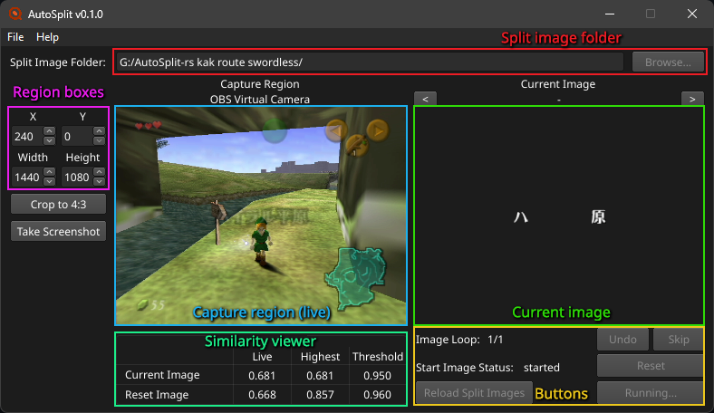

### Split image folder

The folder with your split images, picked with Browse.... Only PNG images are used, in file name order, so number them: `01_FirstSplit.png`, `02_NextSplit.png` and so on. The file name also sets how each image is used, see [Split image file names](#split-image-file-names).

### Capture region

The part of the capture device's picture that split images are compared with, usually the whole game screen. The Capture Region picture shows it live. The region boxes set it: X and Y are where it starts, in pixels of the device's frames, and Width and Height its size. The arrow keys change a box's number by 1.

- For a 4:3 game on a 16:9 canvas, Crop to 4:3 sets the region to the 4:3 picture in the middle of the capture: X 240, Y 0, Width 1440 and Height 1080 on 1920x1080.
- A game that fills the whole capture needs the whole frame, which is what OBS Virtual Camera starts with.
- For a game of another shape, scaled to the capture's height: X = (capture width - game width) / 2, Y 0, Width = game width, Height = capture height.
- A new profile starts at 640x480 in the top left, like Toufool's AutoSplit. With OBS Virtual Camera, that region becomes the whole frame once frames arrive. A region you set yourself is never changed.

Take Screenshot saves the capture region as the next free `NNN_SplitImage.png` in the screenshot folder, or in the split image folder when none is set. Its file name shows under the button for a few seconds.

### Current image

The split image being compared, with its file name above it. `<` and `>` move to the previous and next image without telling the timer.

The similarity viewer under the Capture Region shows, for the current image and the reset image:

| Column | What it is |
| --- | --- |
| Live | How similar the capture is to the image now, from 0 to 1 |
| Highest | The highest it got for this image |
| Threshold | What it has to reach to split |

Image Loop shows which loop of a looping image this is, and Start Image Status whether the start image is being looked for.

### Buttons

| Button | What it does |
| --- | --- |
| Start Auto Splitter | Starts comparing the split images. It doesn't start the timer: start that yourself, or press the split hotkey, which the timer hears too. With a start image, AutoSplit-rs looks for it as soon as the folder loads, and Start Auto Splitter skips it. |
| Reset | Stops comparing, without resetting the timer. |
| Undo and Skip | Move to the previous or next split, and press the undo or skip hotkey so the timer moves too. |
| Reload Split Images | Reads the split image folder again. Changes to the folder are only picked up by this button, a run start, or changing the folder or profile. |

Help > View Log lists everything AutoSplit-rs did and why, like why it didn't split. The same log is in `autosplit.log` next to the program, or in the temp folder when that folder is read-only (`~/.cache/autosplit` on Linux).

## Make Split Images

File > Make Split Images makes split images from a preset: a category's splits, each with a mask that keeps only the part of the screen that tells the split apart, and the threshold, pause, delay and flags it needs. AutoSplit-rs comes with presets for some categories, and you can make your own, see [Editing presets](#editing-presets).

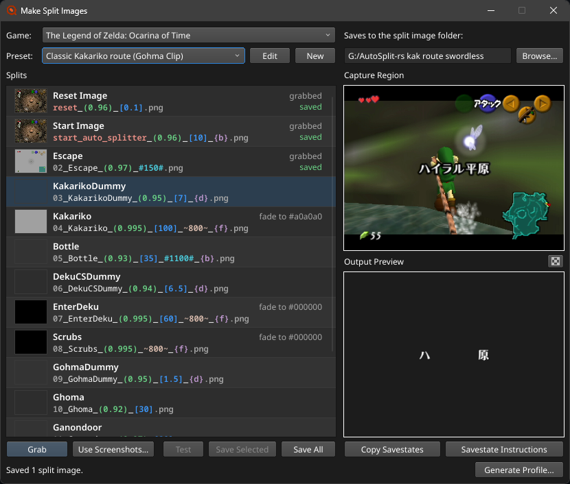

It opens beside the main window. While it's open, the main window only has the Help menu and Settings, so set the capture region first. The split images are saved into the profile's split image folder, which Browse... in this window changes.

The list shows each split's name over its file name, colored by what each part of the name does, and what its image is made from. The file names use the profile's defaults for what the preset leaves out, and are numbered from 0, like Toufool's AutoSplit reads them.

### Making the images

- Grab saves the capture region for the selected split, with its mask, and selects the next split. The screenshot hotkey does the same while the window is open, so you can play through the category and press it at each split.
- Use Screenshots... uses screenshot files instead, like the ones Take Screenshot saves. Pick one for the selected split, or several for the splits in order. Then press Save Selected or Save All.
- Test opens the selected split's saved image in the [Live Tester](#live-tester).

Saving asks before replacing split images, and before leaving older images of the same splits under other names, like after a threshold changed. Delete Old Images removes those, Keep Old Images keeps them. A green check mark over the Output Preview shows when images are saved. Screenshots that were in the split image folder move into its `base` folder, where they aren't read as split images.

The main window reads the split image folder again when Make Split Images closes. What you grabbed or picked is kept until AutoSplit-rs closes, so Save All can save it again into another folder.

### Output Preview

Until a split has an image, the Output Preview shows the capture with the split's mask, as Grab would save it. Click it, or the checkerboard button above it, to show what the mask removes as a checkerboard.

### Generate Profile

Generate Profile... saves the current settings as a new profile named after the game and preset, like `tlozoot_no_wrong_warp.toml`, with the split image folder in it. Then it asks whether to load it. For a preset that compares several images for one split, the profile has [Compare images with the same number for one split](#several-images-for-one-split) turned on, which the folder needs. Until that setting is on, the bottom line says so, with a Turn It On button.

### Savestates

Some presets come with savestates for a practice tool on the console, like gz for Ocarina of Time (`.gzs` files), to get to each split's screen quickly.

- Copy Savestates puts them on the clipboard, numbered like the split images, to paste where the practice tool loads them from, like its folder on the SD card. On Linux, AutoSplit-rs holds them on the clipboard itself, so paste them before closing it.
- Savestate Instructions shows what to do with savestates that need more than loading, in large text. The card of the split selected in Make Split Images is highlighted, so it follows along as you grab, and clicking a card selects its split.

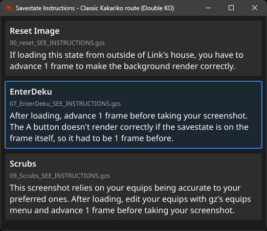

A preset with something that needs fixing shows what in the bottom line, with the split's name in red. Grab, saving and the other buttons wait until it's fixed. Fix It opens the preset in the editor.

## Editing presets

Edit, next to the preset, edits it, and New starts a new preset for the same game. The window title shows which preset is being edited, with a `*` in front while it has unsaved changes.

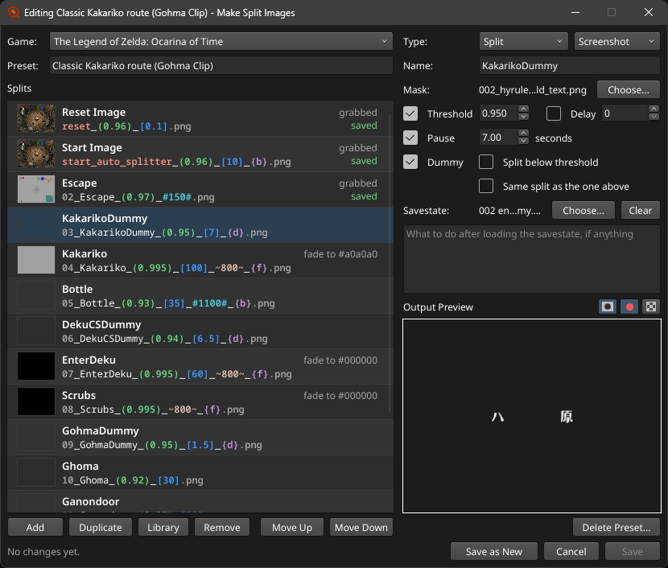

- The game is picked from a list of the games with presets, or typed after New game....
- Add, Duplicate, Remove, Move Up and Move Down change the splits. Add puts the cursor in the new split's name.
- Library opens the split library: the ready-made splits for the preset's game.
  - The list on the left has their names. The search field above it narrows them by name and description. Down or Enter in the search field goes to the list.
  - The one you pick shows on the right: a screenshot its mask fits, its settings, what it's for, and the file name its split image gets, with `XX` for the number that comes from where you put it.
  - Insert Above and Insert Below put it around the selected split. While the pointer is over them, a line in the split list shows where. Enter in the list does the same as Insert Below. Insert Below selects the new split and Insert Above keeps the selected one, so either way the next one goes after the last one inserted.
  - You can also drag a split by the dots at the start of its row into the split list. The line follows the pointer, and the list scrolls when you drag near or past its top or bottom. Under Wayland, where windows don't know their place on the screen, only the buttons and keys work.
  - Splits compared together are never split up: a split goes before or after them.
  - Some ready-made splits take several images in a row, like a dummy for a boss's intro text and then its death. They're inserted together, a split for each image.
  - If the preset already has a split with the same name, its row shows where: that split's number, colored like in the split list's file names, or `reset` or `start` for a reset or start image.
  - A grayed-out name can't be inserted, like a fifth reset image. When you pick it, a red line above the buttons says why.
  - The window stays open. Saving the preset copies the masks and savestates of inserted splits into it.

  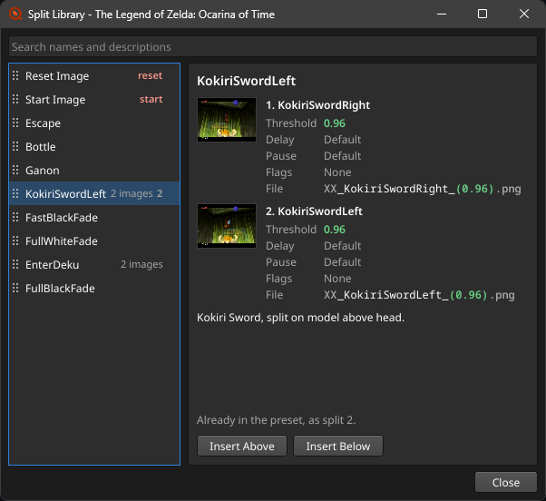

- Grabs and screenshots stay with their splits while you change them. Grab itself is hidden while editing, since a split's file name and mask aren't settled until the preset is saved.

Each split has:

| Field | What it is |
| --- | --- |
| Type | Split, Start Image or Reset Image. Start and reset images are named `start_auto_splitter` and `reset`, so their name can't be changed. A preset can have up to 4 of each. |
| Name | The part of the file name after the number. It can't contain `reset` or `start_auto_splitter`, or the characters `#@{}()[]^`, which file names use for settings. |
| Mask | A PNG that's opaque where the screen is compared. |
| Threshold, Delay, Pause | Unticked, they use the profile's default and stay out of the file name. Changing a value ticks it. |
| Dummy, Split below threshold | The `{d}` and `{b}` flags. |
| Same split as the one above | Compares the split for the same split as the one above it, so either one matching splits. Up to 4 splits can be together. See [Several images for one split](#several-images-for-one-split). |
| Savestate and instructions | For Copy Savestates and Savestate Instructions. |

The Output Preview has two more buttons while editing:

| Mask | Live | Shows |
| --- | --- | --- |
| On | On | The live capture with the mask |
| Off | On | The live capture as it is |
| On | Off | The split's grab or screenshot with the mask, or the mask itself when it has neither |
| Off | Off | The split's grab or screenshot as it is |

A split without a mask yet shows the live capture as it is, so you can see the screen while making one.

### Problems and saving

Splits with something to fix have a red name. The bottom line shows the first problem and how many more there are. Click it, or press F8, to go to the next split with a problem. Hover over it, or the red `!` beside it, to see them all.

- Save saves the preset and ends editing. Masks and savestates picked from elsewhere are copied into the preset, and ones it doesn't use anymore are deleted.
- Save as New saves the changes as another preset and leaves the old one as it was. If the game already has a preset with that name, the new one is called `Name (2)`.
- Cancel, closing the window or quitting asks before throwing changes away.
- Delete Preset asks, then deletes the preset with its masks and savestates, and ends editing. A preset that was never saved has nothing to delete yet.

## Live Tester

File > Live Tester compares one split image with the capture region, without starting a run, to check an image before you rely on it.

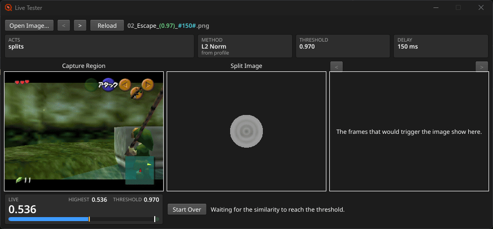

- It opens the split image folder's first image. Open Image... picks another one from any folder, and `<` and `>` beside it open the previous and next image in that folder.
- The image reloads by itself when its file changes, like when Make Split Images saves it again. Reload does it by hand.
- The file name is colored by what each part does. Hover over a part to see what it does. Ignored values are orange and listed below.
- The main window can't be used while the tester is open, apart from Settings and Help. During a run, Undo, Skip and Reset stay usable beside the Settings button.

Live, Highest and Threshold work like in the similarity viewer. The bar under Live fills up to the similarity, and its green end is the threshold. A match is often a single frame, so an orange mark shows the highest similarity, and Highest keeps a green dot once it reached the threshold, until you press Start Over.

The right side keeps the frames that would have made the image act in a run:

- A plain image keeps the first frame that reaches the threshold.
- With a delay, it also keeps the frame when the delay is over, which is when the split happens.
- With `{b}`, it keeps the frame that reached the threshold, the frame that dropped back below it, and the frame after the delay if there is one.
- A dummy image (`{d}`) acts right away, without its delay.
- A reset image keeps the frame that reached the threshold.

`<` and `>` above the frames go through them. Start Over clears them and Highest. The tester takes one image at a time, so the images of a [grouped split](#several-images-for-one-split) are tested one by one.

## Settings

File > Settings has four tabs.

### Capture Settings

| Setting | What it does |
| --- | --- |
| Comparison FPS Limit | How often the capture is compared, 20 to 240 times a second. Set it near the game's frame rate. More only costs CPU. |
| Live Capture Region | Shows the Capture Region live. Turn it off once the region is right to save a little CPU. |
| Show Pause Timer | Shows the seconds left of a pause or a split delay next to Current Image. |
| Capture device | The device to capture from, found by name, so it keeps working when other devices come and go. Refresh lists the devices again. A profile without one gets OBS Virtual Camera when it's there. |
| Screenshots folder | Where Take Screenshot and the Screenshot on options save. Open screenshots on capture opens each one. |
| Screenshot on Start, Split, Reset, Skip, Undo, Pause | Takes a screenshot when that happens, to check later what split. |

### Image Settings

The defaults for split images whose file names don't set their own.

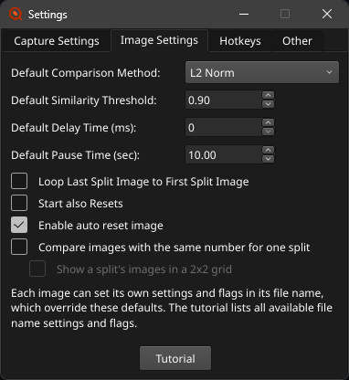

| Setting | What it does |
| --- | --- |
| Default Comparison Method | L2 Norm compares every pixel, fast and fine for most images. Histograms compares the colors, good for masked images. pHash compares the overall shape, so don't use it with masked images. |
| Default Similarity Threshold | The similarity an image has to reach to split. |
| Default Delay Time | How long to wait after a match before splitting, in milliseconds. |
| Default Pause Time | How long to stop comparing after a split, in seconds. It keeps two similar images in a row from splitting at once. |
| Loop Last Split Image to First Split Image | After the last image splits, start over with the first. |
| Start also Resets | When the start image matches, reset the timer first, then start it. |
| Enable auto reset image | Use the reset image. The toggle auto reset image hotkey turns it on and off. |
| Compare images with the same number for one split | See [Several images for one split](#several-images-for-one-split). |
| Show a split's images in a 2x2 grid | Shows a split's images side by side in the current image area. |

### Hotkeys

The split, reset, undo, skip and pause hotkeys must match your timer's, with global hotkeys turned on in the timer. AutoSplit-rs presses them and also listens for them, so pressing the split hotkey yourself starts a run and reset stops it. The pause hotkey is only pressed for images with the `{p}` flag. The screenshot hotkey takes a screenshot, or grabs the selected split while Make Split Images is open. The toggle auto reset image hotkey turns the reset image on and off.

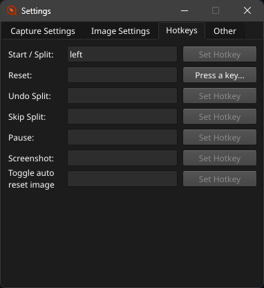

- Click Set Hotkey and press the key, with any modifiers. Escape clears it, and clicking Set Hotkey again cancels.
- Or type a name in the field and press Enter, like `num 1`, `ctrl+shift+f5`, `page up` or `plus`.
- A key can only be used once. Setting it for one action clears it from another.
- Keypad keys are `num 0` to `num 9`, `decimal`, `plus`, `-`, `*` and `/`, whether Num Lock is on or not. Shift+1 is `shift+1`.
- On Linux and macOS, names follow a US keyboard, so with another layout a key can show under its US name, like `y` for the key labelled Z on a German keyboard. It still listens for the key you pressed.
- On macOS, the menu bar is empty while Set Hotkey waits for a key, so keys with Cmd, like Cmd+Q, can be set.

With LiveSplit or LiveSplit One controlling the timer, only the screenshot and toggle auto reset image hotkeys are used.

### Other

| Setting | What it does |
| --- | --- |
| Timer | Any timer (hotkeys), LiveSplit One (WebSocket), or Molok (POSIX signals, Linux only). See [Timers](#timers). |
| LiveSplit One port | The port LiveSplit One connects to, 16835 by default. A typed port is used once you press Enter or leave the box. |

## Split image file names

A split image's file name can set its own values, which override the defaults from Image Settings.

| Setting | Written as | Example |
| --- | --- | --- |
| Similarity threshold | between parentheses | `(0.95)` |
| Pause after the split, in seconds | between square brackets | `[10]` |
| Delay before splitting, in milliseconds | between hash signs | `#3500#` |
| Times to split on this image in a row | between at signs | `@3@` |
| Comparison method: 0 L2 Norm, 1 Histograms, 2 pHash | between carets | `^1^` |
| Flags | between curly brackets | `{db}` |

Flags, several of which can go in one pair of brackets:

- `{d}`: dummy split. When it matches, AutoSplit-rs moves on to the next image without splitting.
- `{b}`: split when the similarity drops below the threshold, after it went above it.
- `{p}`: press the pause hotkey instead of the split hotkey.

Examples:

- `01_Boss_(0.9)_[10].png`: threshold 0.9, then stop comparing for 10 seconds.
- `02_Boss_(0.9)_[10]_{d}.png`: the same, as a dummy split.
- `03_Door_(0.85)_[20]_#3500#.png`: threshold 0.85, splits 3.5 seconds after matching, then pauses 20 seconds.
- `04_Text_(0.9)_[10]_#3500#_@3@_{b}.png`: also splits 3 times in a row, each time when the similarity drops below 0.9.

Values need their closing character, so `(0.9` sets nothing.

### Start image

An image with `start_auto_splitter` in its name, as a whole word, starts the timer when it matches, before the run. Its pause time is the wait before comparing the first split image, and its delay is the wait before starting the timer. After changing it, press Reload Split Images.

### Reset image

An image with `reset` in its name, as a whole word, resets the timer when it matches during the run. `preset_menu.png` is a normal split image. Its pause time is how long after the start it waits before looking, like `reset_(0.95)_[10].png`.

### Masked images

When only part of the screen is always the same, like text over a changing background, make the rest transparent. Only the parts that aren't transparent are compared. Make Split Images does this with a preset's masks. By hand, take a screenshot and erase the rest in an editor like paint.net or GIMP. Use L2 Norm or Histograms for these, not pHash.

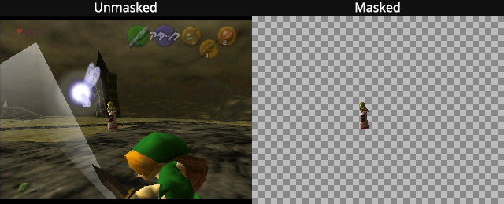

### Several images for one split

Some splits look different from run to run, like a boss that dies in one of two rooms. With Compare images with the same number for one split turned on, up to 4 images with the same number are compared for one split, and the first that matches splits:

- `01_boss_left.png` and `01_boss_right_(0.85).png`: split 1 matches either room.
- `02_door.png`: split 2.

- Every split image needs a number at the start, or the folder won't load. `1_a.png` and `01_b.png` are the same split.
- Each image keeps its own threshold, comparison method and `{b}` flag. The image that matched decides the delay, pause and `{d}` or `{p}` flag.
- The images of a split need the same loop count.
- A folder can also have up to 4 start images and up to 4 reset images, like `reset.png` and `reset_2.png`. Without the setting, a folder with more than one is refused.
- The similarity viewer gets a row for each image. With Show a split's images in a 2x2 grid, the current image area shows them all.

## Profiles

A profile (`.toml`) holds all the settings, including the capture region. File > Save Profile, Save Profile As and Load Profile save and open them. If there's exactly one `.toml` file next to the program, it's loaded at start. Profiles from Toufool's AutoSplit load as they are, and profiles saved here load there. Closing with unsaved changes asks whether to save them.

### Making a profile by hand

Keys you leave out get the settings window's defaults.

```toml
split_hotkey = "num 1"
reset_hotkey = "num 3"
undo_split_hotkey = "num 8"
skip_split_hotkey = "num 2"
capture_method = "VIDEO_CAPTURE_DEVICE"
capture_device_name = "OBS Virtual Camera"  # as `autosplit devices` shows it
split_image_directory = "/Users/me/Splits/OoT Any%"  # on Windows, use / or 'single quotes'
default_similarity_threshold = 0.95
timer_connection = "livesplit_one"  # optional, see Timers
group_split_images = true  # optional, see Several images for one split
split_image_grid = true  # optional, shows those images in a 2x2 grid

[capture_region]  # in pixels of the device's frames; `autosplit grab` shows their size
x = 0
y = 0
width = 1920
height = 1080
```

Keys after `[capture_region]` belong to it, so put new ones above it. The four hotkeys aren't needed with `timer_connection = "livesplit_one"` or `"molok"`. Relative folders are read from the profile's folder.

### Moving a profile to another computer

A profile works on another computer with the same capture hardware and console.

- Change the split image folder to where the images are now.
- Device names can differ between systems, so pick the device again in Settings.
- If the device's frames have another size there, change the capture region to match.

## Timers

### LiveSplit (Windows)

LiveSplit controls AutoSplit-rs through its AutoSplit Integration component, like it does Toufool's AutoSplit. Get `LiveSplit.AutoSplitIntegration.dll` from the component's [releases](https://github.com/Toufool/LiveSplit.AutoSplitIntegration/releases/latest) and put it in LiveSplit's `Components` folder. Then add AutoSplit Integration to your layout, and in its settings choose `AutoSplit.exe` and your profile.

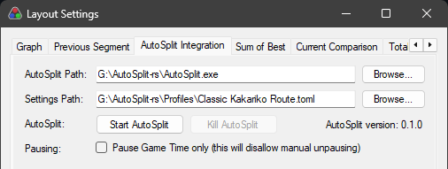

LiveSplit starts AutoSplit-rs with your layout and tells it when the timer starts, splits, skips, undoes and resets. The window title says "(externally controlled)". If the component already runs Toufool's AutoSplit, point it at `AutoSplit.exe` instead and keep your profile.

### LiveSplit One

AutoSplit-rs controls LiveSplit One, the web version or the desktop app, without hotkeys. Choose LiveSplit One (WebSocket) in Settings > Other. Then choose Connect to Server in LiveSplit One's menu and enter `ws://localhost:16835`, or the port you set.

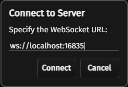

- AutoSplit-rs sends starts, splits, resets and pauses. Resets save the attempt without asking.
- Starting, splitting, skipping, undoing and resetting in LiveSplit One moves AutoSplit-rs along too.
- Start AutoSplit-rs first. LiveSplit One doesn't reconnect by itself, so after restarting AutoSplit-rs or changing the port, choose Connect to Server again.
- LiveSplit One must run on the same computer, and only one can be connected.
- If the browser refuses to connect, use Chrome, Edge or Firefox, or the desktop app. Chrome and Edge may ask whether one.livesplit.org may access devices on your network: allow it.

Toufool's AutoSplit ignores these settings, so the profile keeps working there.

### Molok (Linux)

Molok is a Linux timer controlled with signals. Choose Molok (POSIX signals) in Settings > Other, and AutoSplit-rs signals every running process named `molok`:

| Command | Signal |
| --- | --- |
| Start and split | `SIGRTMIN+0` |
| Skip split | `SIGRTMIN+1` |
| Undo split | `SIGRTMIN+2` |
| Reset | `SIGRTMIN+3` |
| Pause (images with the `{p}` flag) | `SIGRTMIN+4` |

- Molok doesn't report back. When you split, reset or undo in Molok, AutoSplit-rs only follows if you used the same keys as its hotkeys.
- Start the run with the start image, Start Auto Splitter or the split hotkey. Start Auto Splitter alone doesn't start Molok.
- Molok must run as your user.
- With Start also Resets, the start signal comes 5 milliseconds after the reset, so Molok handles them in that order.

### Any other timer

AutoSplit-rs presses the profile's hotkeys, and the timer listens for them as global hotkeys. Set the same keys in both, see [Hotkeys](#hotkeys).

## Keyboard shortcuts

On macOS, use Cmd where this says Ctrl, and Option for Alt.

| Shortcut | Where | What it does |
| --- | --- | --- |
| Ctrl+, | Main window, Settings, Live Tester, Make Split Images | Settings |
| Ctrl+T | Main window, Settings | Live Tester |
| Ctrl+M (Cmd+Shift+M on macOS) | Main window, Settings | Make Split Images |
| Ctrl+S, Ctrl+Shift+S | Main window, Settings | Save Profile, Save Profile As |
| Ctrl+O | Main window, Settings | Load Profile |
| F1 (Cmd+? on macOS) | Main window, Settings, Live Tester, Make Split Images | View Help |
| Escape | Settings, tool windows, small windows | Close the window, or cancel editing a preset |
| Arrow keys | Region boxes | Change the number by 1 |
| Ctrl+S | Editing a preset | Save, or list what to fix first |
| F8 | Editing a preset | Go to the next split with a problem |
| Alt+Up, Alt+Down | Editing a preset | Move the selected split |
| Ctrl+Z | Editing a preset | Bring back removed splits, until something else changes |
| Cmd+M, Cmd+W | Every window, macOS | Minimize, close |

On macOS, Help > About is called Licenses and Links, since the app menu has its own About.

## Permissions

### Linux

- Listening for hotkeys needs to read the keyboards: `sudo usermod -a -G input $USER`, then log out and back in. Any program you run can then read your keystrokes.
- Pressing hotkeys needs `/dev/uinput`: `echo 'KERNEL=="uinput", TAG+="uaccess"' | sudo tee /etc/udev/rules.d/50-uinput.rules`, then restart. If `/dev/uinput` doesn't exist, load it with `sudo modprobe uinput`, and keep it after restarts with `echo uinput | sudo tee /etc/modules-load.d/uinput.conf`. Under WSL, key presses can't be sent.
- Capture devices need the `video` group, which desktop users usually have.
- Without these, AutoSplit-rs still runs and says what's missing. LiveSplit One and Molok need neither hotkey permission, apart from the `input` group for a screenshot or toggle auto reset image hotkey.

### macOS

AutoSplit-rs is a plain program, not an app, so macOS gives permissions to the app that starts it: Terminal when you double-click it, or the terminal app you start it from, like iTerm. AutoSplit-rs itself can't be added to these lists.

- Camera, for capture devices: macOS asks the first time. Click Allow.
- Input Monitoring, for listening to hotkeys, and Accessibility, for pressing them: in System Settings > Privacy & Security, turn on Terminal under both. If it isn't listed, add it with the + button from Applications > Utilities. With LiveSplit One, only a screenshot or toggle auto reset image hotkey needs a permission, and only Input Monitoring.
- Then quit Terminal and start AutoSplit-rs again. Permissions only apply after a restart.
- Every program you start from that terminal app gets the same permissions.

## Linux

- The window works under X11 and Wayland. Wayland doesn't let a program place its windows or keep them on top, so tool windows open where the desktop puts them, and message boxes are drawn inside the windows they block. For X11's behavior, start it through XWayland with `WAYLAND_DISPLAY= ./autosplit`.
- The window needs fontconfig and xkbcommon, and under X11 libxkbcommon-x11 (`libxkbcommon-x11-0` on Debian and Ubuntu). Most desktops have them.
- File pickers use xdg-desktop-portal, which desktops usually have, or zenity. Without either, Browse... says so. When AutoSplit-rs can't start, it says why in the terminal, or otherwise in a zenity box.
- OBS Virtual Camera needs the v4l2loopback kernel module, see [TUTORIAL.md](TUTORIAL.md#virtual-camera-on-linux). Once OBS has loaded it, OBS Virtual Camera is listed even while it's stopped, until you restart the computer. After a restart, start the Virtual Camera before opening Settings, or press Refresh after starting it.
- `./install-desktop-entry.sh` in the unzipped folder adds AutoSplit-rs to the desktop's app menu, with its icon. Run it again after moving the folder, and `./install-desktop-entry.sh --remove` takes it out.

## Command line

Everything also works without the window. Type `.\autosplit` on Windows and `./autosplit` on macOS and Linux, and put paths with spaces in "quotes".

```sh
# List capture devices
autosplit devices

# Save a frame from a capture device, or with --profile only the part that gets compared
autosplit grab --device "OBS Virtual Camera" frame.png [--profile settings.toml]

# Split
autosplit run settings.toml [--split-dir folder]

# Check a profile's split image folder and show how each image is read
autosplit check settings.toml [--split-dir folder]

# Similarity of a split image against a captured frame, with every method
autosplit compare "split_(0.95).png" frame.png [--profile settings.toml]

# The same for each frame in a folder of PNG frames, as CSV with a column per method
autosplit compare "split_(0.95).png" frames/ --fps 60 > similarity.csv

# Run the split logic over a folder of recorded PNG frames
autosplit replay settings.toml frames/ --fps 60 [--auto-controlled]

# Time comparisons
autosplit bench [split images...] --capture 1920x1080
```

`run` prints what happens, with the current split image and its similarity on the last line. Press Ctrl+C to stop. Without a capture device, it shows `NO DEVICE` and looks for the device every 2 seconds.

The Windows zip has two programs. `AutoSplit.exe` opens the window without a console, and `AutoSplit.com` is for terminals: typing `autosplit` in a terminal runs it, so output and Ctrl+C work there.
