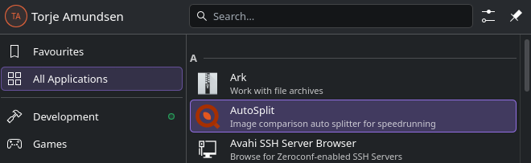
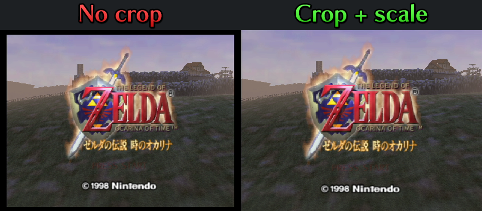
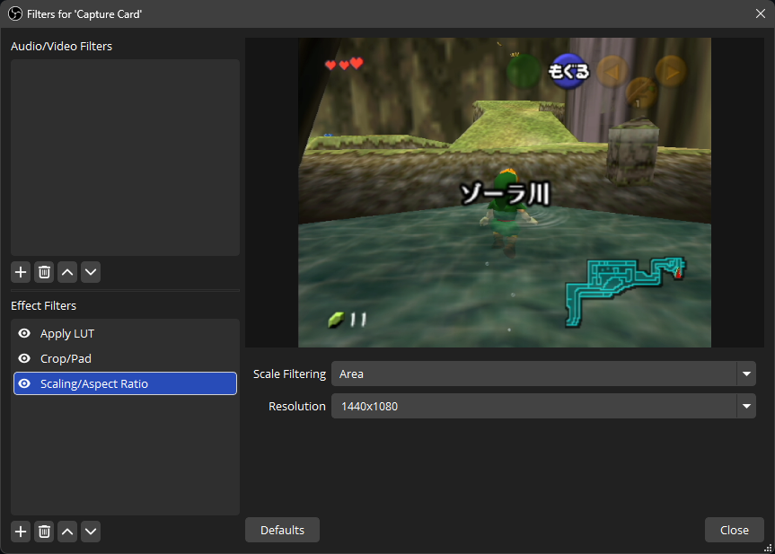
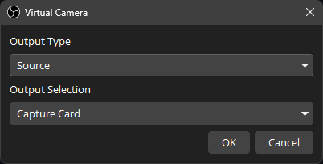
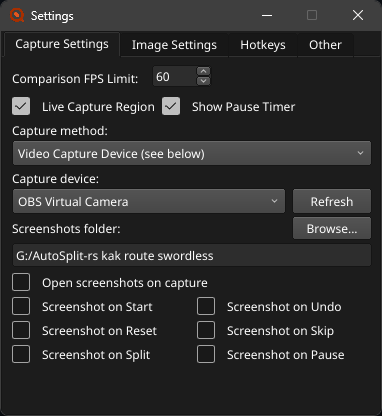
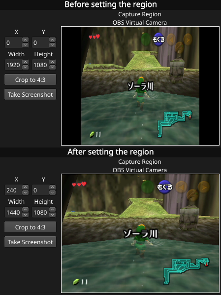
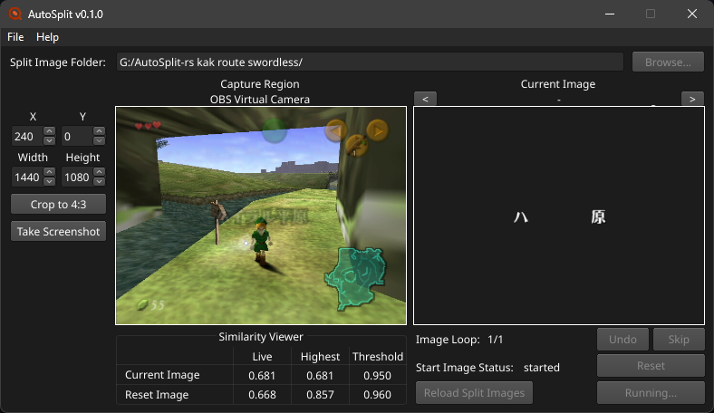

# Tutorial

This guide sets up AutoSplit-rs for your first run, step by step. For everything else, like every setting and file name option, see [MANUAL.md](MANUAL.md).

## How it works

AutoSplit-rs compares your capture with your split images: pictures of what the screen looks like at each split, like when a boss dies. When the capture matches the current split's image closely enough, it splits your timer.

So you need four things:

1. Your capture in AutoSplit-rs. This guide passes it on from OBS.
2. Split images for your splits. Make Split Images makes them for you from a preset for your category.
3. A timer that AutoSplit-rs can control, like LiveSplit.
4. A profile, which keeps all of this for next time.

## 1. Install

Download the zip for your system from the [releases](https://github.com/TorjeAmundsen/AutoSplit-rs/releases) and unzip it somewhere you'll keep it.

### On Windows

Start `AutoSplit.exe`.

### On macOS

AutoSplit-rs needs macOS 11 or newer. macOS blocks the first start, because the program isn't notarized:

1. Open Terminal in the unzipped folder and run `xattr -d com.apple.quarantine autosplit`. Or try to open `autosplit`, then click Open Anyway in System Settings > Privacy & Security.
2. Double-click `autosplit`. It opens in Terminal.
3. Give Terminal the permissions AutoSplit-rs needs: allow the camera when macOS asks, and turn on Terminal under Input Monitoring and Accessibility in System Settings > Privacy & Security. Then quit Terminal and start AutoSplit-rs again. [MANUAL.md](MANUAL.md#macos) explains why Terminal gets them.

### On Linux

1. Let AutoSplit-rs read and press hotkeys: run `sudo usermod -a -G input $USER` and `echo 'KERNEL=="uinput", TAG+="uaccess"' | sudo tee /etc/udev/rules.d/50-uinput.rules`, then restart the computer. [MANUAL.md](MANUAL.md#linux) has the details, and what to skip if you use LiveSplit One or Molok.
2. Run `./autosplit` in the unzipped folder.
3. Optionally, run `./install-desktop-entry.sh` to add AutoSplit-rs to your app menu.

## 2. Set up OBS Virtual Camera

> [!IMPORTANT]
> Crop/Pad has to be above Scaling/Aspect Ratio in the source's filters. OBS runs filters from the top down. With Scaling/Aspect Ratio first, OBS scales the black bars along with the game, then Crop/Pad cuts the bars off the scaled picture. The game ends up smaller than the size you set, and can come out squashed or stretched. Split images made from that feed stop matching once you fix the order. Color correction filters can go anywhere.

OBS's Virtual Camera passes your capture source on to AutoSplit-rs. OBS's [Virtual Camera guide](https://obsproject.com/kb/virtual-camera-guide) explains it, and the notes below cover what macOS and Linux need first. Before starting it, crop and scale the source, so the source is only the game, with no black bars.

1. On your capture source, add a Crop/Pad filter and crop away the black bars. Use the filter, not Alt-dragging in the preview, which the Virtual Camera ignores.
2. Below Crop/Pad, add a Scaling/Aspect Ratio filter that scales the game to fill your canvas's height at its own aspect ratio, with Area filtering. For a 4:3 game, that's 1440x1080 on a 1920x1080 canvas, or 960x720 on 1280x720. A 16:9 game fills the whole canvas.
3. Add any color correction, like a LUT from [AutoLUT](https://torjeamundsen.github.io/AutoLUT/), to the same source. Where it goes in the list doesn't matter. Do it now, since changing colors later means making the split images again.
4. Click the gear next to Start Virtual Camera, set Output Type to Source and pick your capture source. Then start the Virtual Camera.

#### Virtual Camera on macOS

The first time you start the Virtual Camera, macOS asks to allow OBS's camera extension. Allow it in System Settings, under Privacy & Security, or General > Login Items & Extensions on newer macOS. Then start the Virtual Camera again.

#### Virtual Camera on Linux

The Virtual Camera needs the v4l2loopback kernel module:

- Debian and Ubuntu: `sudo apt install v4l2loopback-dkms`
- Fedora, from RPM Fusion: `sudo dnf install v4l2loopback`
- Arch: `sudo pacman -S v4l2loopback-dkms`

OBS loads it when you start the Virtual Camera, and may ask for your password. After restarting the computer, start the Virtual Camera before opening AutoSplit-rs's settings, or press Refresh there.

## 3. Pick the camera and set the capture region

1. In AutoSplit-rs, open File > Settings. On Capture Settings, pick OBS Virtual Camera as the capture device, and close Settings.

   

2. The Capture Region picture now shows the Virtual Camera live: the whole OBS canvas, with the game in the middle.
3. Set the region boxes on the left, so the Capture Region shows only the game:
   - A 4:3 game on a 16:9 canvas: click Crop to 4:3.
   - A game that fills the whole canvas: the region already covers it, so there's nothing to do.
   - Anything else: [MANUAL.md](MANUAL.md#capture-region) shows how to work out the region boxes.

The capture region is what gets compared with your split images, so set it before making any. If you change it later, make the split images again.

## 4. Make your split images

AutoSplit-rs comes with presets for some categories: a list of the category's splits, each with a mask that keeps only the part of the screen that tells the split apart, and the settings it needs. Make Split Images turns your capture into split images with them.

1. Open File > Make Split Images. It opens beside the main window.
2. Pick your game and category's preset at the top.
3. Click Browse... and pick an empty folder for the split images, like a new folder named after your category.
4. Click Generate Profile..., save the profile, and choose Load It. This saves your settings, with that folder, as a profile for this category.
5. Set a screenshot hotkey in File > Settings > Hotkeys, if you don't have one. Pick a key you can press while playing.
6. Get to each split's screen. If Copy Savestates can be clicked, your preset has savestates: load them as in [Savestates](#savestates) below instead of playing. Otherwise, play through the category. At each split, when the screen looks like the split's moment, press the screenshot hotkey, or click Grab. The Output Preview shows what the image will look like before you grab. A grab saves the image of the split that's selected, and right away selects the next split, so the selected split is always the one you grab next. The split you just grabbed flashes green with a check mark on its picture.
7. Close Make Split Images when every split is grabbed.

If a grab didn't come out right, select that split and grab it again.

Some splits are fade splits, which split when the screen fades to a color, like the fade to black when you leave an area. Their image is made from the color, not the capture, so when one is selected the button reads Grab*. Click it, or press the screenshot hotkey, to save it and move on, wherever you are in the game. They need no savestate.

### Savestates

Some presets come with savestates for a practice tool on the console, like gz for Ocarina of Time. Each one loads the game on the exact frame its split's mask was made for, so if your preset has them, use them instead of playing through the category:

1. Click Copy Savestates, and paste them where the practice tool loads them from, like its folder on the SD card. Only get them with Copy Savestates: it numbers them in the order of the splits, like the split images.
2. Select the first split in Make Split Images.
3. Load the split's savestate, and grab. If Savestate Instructions has a card for the split, do what it says first.
4. Load the next savestate and grab again, in order, until every split is grabbed. Grab selects the next split for you, so the selected split always matches the next savestate. A fade split has no savestate: click Grab* and go on to the next one.

Savestate Instructions shows the steps for the savestates that need more than loading, and highlights the split you're on.

### Without a preset

If there's no preset for your category, take your own screenshots: click Take Screenshot at each split, rename the files in order, like `01_FirstBoss.png`, and erase what changes from run to run in an image editor. [MANUAL.md](MANUAL.md#split-image-file-names) explains file names and masks. You can also make a preset yourself, see [Editing presets](MANUAL.md#editing-presets).

## 5. Check your split images

Before your first run, check that each image matches when it should. File > Live Tester compares one image with the capture, without a run.

1. Open File > Live Tester. It shows the first image of your split image folder. Use `<` and `>` beside Open Image... for the others.
2. Get to that split's screen in the game.
3. Watch the bar: when it reaches the black line, the threshold, the image matches, and the frame it matched on appears on the right.

If an image never matches, check that the capture region hasn't changed since you grabbed it, and that OBS's colors and filters are the same. If it matches too early, on a screen that only looks similar, see [Troubleshooting](#troubleshooting).

## 6. Connect your timer

Pick one:

### LiveSplit (Windows)

LiveSplit starts AutoSplit-rs itself and tells it about every start, split and reset.

1. Download `LiveSplit.AutoSplitIntegration.dll` from the [AutoSplit Integration releases](https://github.com/Toufool/LiveSplit.AutoSplitIntegration/releases/latest).
2. Close LiveSplit, put the file in LiveSplit's `Components` folder, and start LiveSplit again.
3. Right-click LiveSplit, choose Edit Layout..., click +, and add AutoSplit Integration from the Control category.
4. Open Layout Settings, and on the AutoSplit Integration tab, choose `AutoSplit.exe` and your profile.

From now on, LiveSplit opens AutoSplit-rs with your layout. Close the AutoSplit-rs you started yourself, so only LiveSplit's is running.

### LiveSplit One

Works on Windows, macOS and Linux, with no hotkeys or permissions.

1. In AutoSplit-rs, open File > Settings > Other and choose LiveSplit One (WebSocket) as the timer.
2. In [LiveSplit One](https://one.livesplit.org), choose Connect to Server from its menu and enter `ws://localhost:16835`.

LiveSplit One doesn't reconnect by itself, so connect again each time you start AutoSplit-rs.

### Another timer

AutoSplit-rs presses your timer's hotkeys. Set the same split, reset, undo, skip and pause keys in File > Settings > Hotkeys as in your timer, and turn on global hotkeys in the timer. On Linux, [Molok](MANUAL.md#molok-linux) can be controlled directly.

## 7. Do a run

1. Save your profile with File > Save Profile, if you changed anything since Generate Profile.
2. Click Start Auto Splitter, or start your timer. With LiveSplit or LiveSplit One, starting the timer starts AutoSplit-rs too.
3. Play. Current Image shows the split image being compared, and the similarity viewer below the Capture Region how close the capture is to it.

Next time, start AutoSplit-rs (or LiveSplit), start the Virtual Camera in OBS, and run. The profile remembers everything else. If there's exactly one profile next to the program, it's loaded at start, otherwise use File > Load Profile.

## Troubleshooting

Help > View Log says what AutoSplit-rs did and why, like why it didn't split. Start there.

**The Capture Region is gray, or says OBS Virtual Camera isn't started.** Start the Virtual Camera in OBS.

**The game is smaller than the size set in Scaling/Aspect Ratio.** Scaling/Aspect Ratio is above Crop/Pad in the source's filters. Drag it below Crop/Pad, see [Set up OBS Virtual Camera](#2-set-up-obs-virtual-camera).

**OBS Virtual Camera isn't in the device list.** Start the Virtual Camera, then press Refresh in Settings. On Linux, install v4l2loopback, see [Virtual Camera on Linux](#virtual-camera-on-linux). On macOS, allow the camera for Terminal.

**It never splits.** Watch the similarity viewer during the split: Live has to reach Threshold.
- Far below: the capture changed since the image was made. Check the capture region, OBS's crop and color filters, and the capture card's settings, then grab the image again.
- Just below: lower that split's threshold a little. For a preset's split, change it with the pencil button next to the preset in Make Split Images, save the preset and save the image again. Otherwise, change it in the image's file name, like `(0.88)`.

**It splits too early.** Another screen looks similar enough. Raise that split's threshold, the same way, or give the split before it a longer pause, so it isn't compared during the similar screen. [MANUAL.md](MANUAL.md#split-image-file-names) lists every file name option.

**The timer doesn't react, but AutoSplit-rs moves on.** With hotkeys, the keys in Settings > Hotkeys must be the timer's, with the timer's global hotkeys on. On Linux and macOS, check the [permissions](MANUAL.md#permissions). Or use LiveSplit One, which needs no hotkeys.

**It splits twice on one screen.** Give that split a pause, so it stops comparing for a while after splitting.
