# Tutorial

This guide sets up AutoSplit-rs for your first run, step by step. For everything else, like every setting and file name option, see [MANUAL.md](MANUAL.md).

## How it works

AutoSplit-rs compares your capture with your split images: pictures of what the screen looks like at each split, like when a boss dies. When the capture matches the current split's image closely enough, it splits your timer.

So you need four things:

1. Your capture in AutoSplit-rs. This guide passes it on from OBS.
2. Split images for your splits. Make Split Images makes them from a preset for your category.
3. A timer that AutoSplit-rs can control, like LiveSplit.
4. A profile, which keeps all of this for next time.

### The quickest setup: a console with an HDMI output

A console with an HDMI output, like the Switch 2, shows everyone the same picture. So a preset for it can come with screenshots of every split, and Make Split Images makes all your split images from them with one click. You don't play through the category, load savestates or press a hotkey at each split.

For that, the capture has to be the console's picture as it is: no cropping, no scaling filters and no color correction in OBS. This guide points out where that matters. An analog capture, like a console over component or composite, needs a few more steps, which are marked as such.

## 1. Install

Download the zip for your system from the [releases](https://github.com/TorjeAmundsen/AutoSplit-rs/releases), and unzip it somewhere you'll keep it, like your Documents folder. AutoSplit-rs needs no installer.

### On Windows

Start `AutoSplit.exe`. If Windows says it protected your PC, click More info, then Run anyway. That only happens the first time, because the program isn't signed.

### On macOS

AutoSplit-rs needs macOS 11 or newer. macOS blocks the first start, because the program isn't notarized:

1. Open Terminal in the unzipped folder and run `xattr -d com.apple.quarantine autosplit`. Or try to open `autosplit`, then click Open Anyway in System Settings > Privacy & Security.
2. Double-click `autosplit`. It opens in Terminal.
3. Give Terminal the permissions AutoSplit-rs needs: allow the camera when macOS asks, and turn on Terminal under Input Monitoring and Accessibility in System Settings > Privacy & Security. Then quit Terminal and start AutoSplit-rs again. [MANUAL.md](MANUAL.md#macos) explains why Terminal gets them.

### On Linux

1. Run `./autosplit` in the unzipped folder.
2. Optionally, run `./install-desktop-entry.sh` to add AutoSplit-rs to your app menu.
3. To use hotkeys, let AutoSplit-rs read and press them: run `sudo usermod -a -G input $USER` and `echo 'KERNEL=="uinput", TAG+="uaccess"' | sudo tee /etc/udev/rules.d/50-uinput.rules`, then restart the computer. With LiveSplit One or Molok as your timer and a preset with screenshots, you can skip this. [MANUAL.md](MANUAL.md#linux) has the details.

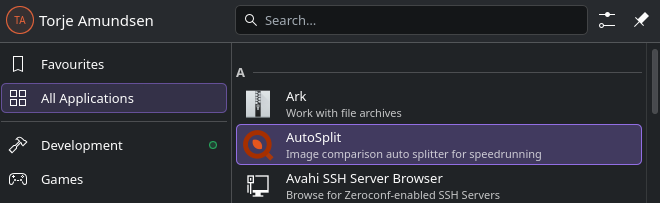

## 2. Set up OBS Virtual Camera

A capture card can usually only be used by one program at a time. OBS's Virtual Camera passes your capture source on to AutoSplit-rs, so OBS keeps showing it too. OBS's [Virtual Camera guide](https://obsproject.com/kb/virtual-camera-guide) explains it, and the notes below cover what macOS and Linux need first. If you don't use OBS, skip this step and pick your capture card itself in step 3.

### An HDMI capture

1. Leave the capture source as it is: no Crop/Pad, Scaling/Aspect Ratio or color correction filters. The console's HDMI picture is already only the game, at its full resolution.
2. To make it smaller in your layout, like to fit your splits beside it, resize and move it in the scene instead, by dragging its corners or with Edit Transform. The Virtual Camera sends the source as its filters leave it, whatever its size in the scene.
3. Click the gear next to Start Virtual Camera, set Output Type to Source and pick your capture source. Then start the Virtual Camera.

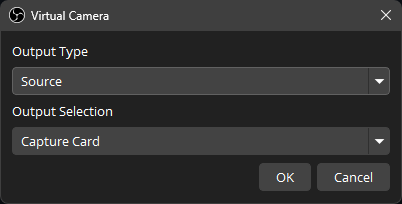

### An analog capture

An analog capture usually has black bars around the game. Crop and scale it first, so the source is only the game.

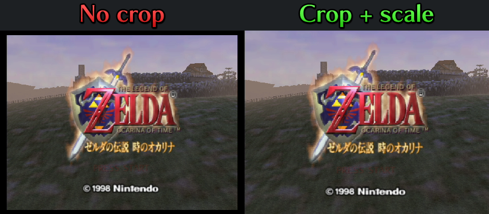

> [!IMPORTANT]
> Crop/Pad has to be above Scaling/Aspect Ratio in the source's filters. OBS runs filters from the top down. With Scaling/Aspect Ratio first, OBS scales the black bars along with the game, then Crop/Pad cuts the bars off the scaled picture. The game ends up smaller than the size you set, and can come out squashed or stretched. Split images made from that feed stop matching once you fix the order.

1. Add a Crop/Pad filter on your capture source and crop away the black bars. Use the filter, not Alt-dragging in the preview, which the Virtual Camera ignores.
2. Add a Scaling/Aspect Ratio filter below Crop/Pad that scales the game to fill your canvas's height at its own aspect ratio, with Area filtering. For a 4:3 game, that's 1440x1080 on a 1920x1080 canvas, or 960x720 on 1280x720. A 16:9 game fills the whole canvas.
3. Add any color correction now, like a LUT from [AutoLUT](https://torjeamundsen.github.io/AutoLUT/), to the same source. Where it goes in the list doesn't matter. Changing colors later means making the split images again.
4. Click the gear next to Start Virtual Camera, set Output Type to Source and pick your capture source. Then start the Virtual Camera.

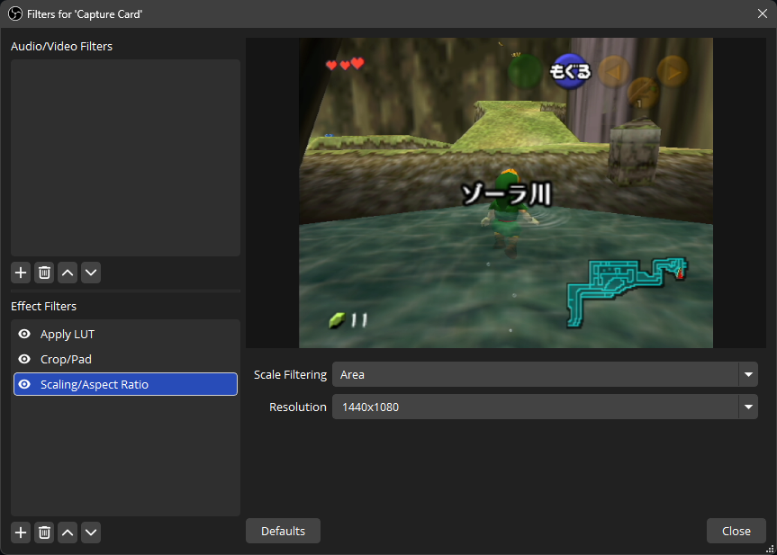

### Virtual Camera on macOS

The first time you start the Virtual Camera, macOS asks to allow OBS's camera extension. Allow it in System Settings, under Privacy & Security, or General > Login Items & Extensions on newer macOS. Then start the Virtual Camera again.

### Virtual Camera on Linux

The Virtual Camera needs the v4l2loopback kernel module:

- Debian and Ubuntu: `sudo apt install v4l2loopback-dkms`
- Fedora, from RPM Fusion: `sudo dnf install v4l2loopback`
- Arch: `sudo pacman -S v4l2loopback-dkms`

OBS loads it when you start the Virtual Camera, and may ask for your password. After restarting the computer, start the Virtual Camera before opening AutoSplit-rs's settings, or press Refresh there.

## 3. Pick the camera and set the capture region

1. In AutoSplit-rs, open File > Settings. On Capture Settings, pick OBS Virtual Camera as the capture device, or your capture card without OBS, and close Settings.

   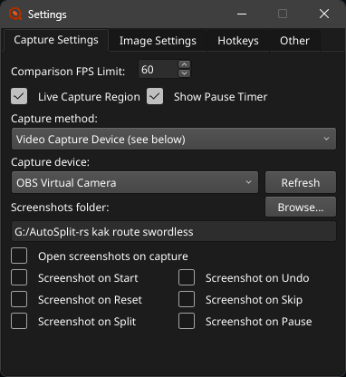

2. The Capture Region picture now shows your capture live.
3. Set the region boxes on the left, so the Capture Region shows only the game:
   - An HDMI capture, or any game that fills the whole picture: the region already covers it, so there's nothing to do.
   - A 4:3 game on a 16:9 canvas: click Crop to 4:3.
   - Anything else: [MANUAL.md](MANUAL.md#capture-region) shows how to work out the region boxes.

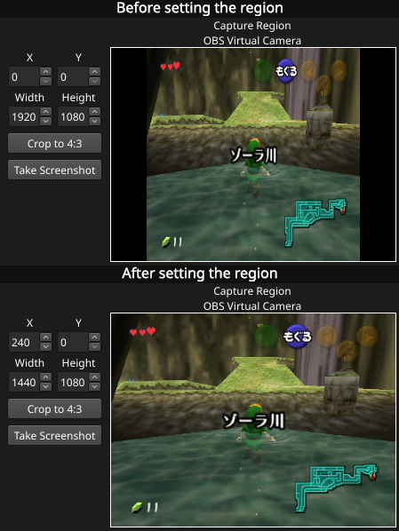

The capture region is what gets compared with your split images, so set it before making any. If you change it later, make the split images again.

> [!NOTE]
> A game that isn't 4:3, like any 16:9 HDMI game, looks squashed in the Capture Region, and in the pictures in Make Split Images and the Live Tester. That's on purpose, not something you set wrong. Those pictures are 4:3, the shape AutoSplit-rs compares a whole screen at, so they show what the comparison sees. Your split images keep the game's real shape.

## 4. Make your split images

AutoSplit-rs comes with presets for some categories: a list of the category's splits, each with a mask that keeps only the part of the screen that tells the split apart, and the settings it needs. Some also come with a screenshot of each split. Make Split Images turns them into your split images.

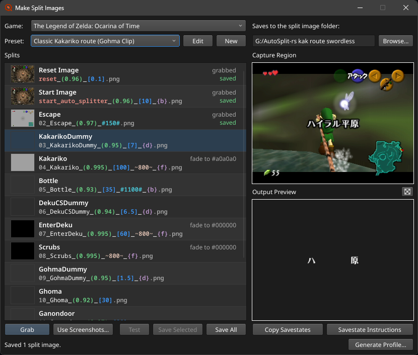

1. Open File > Make Split Images. It opens beside the main window.
2. Pick your game and category's preset at the top. If it comes with screenshots, the bottom line says how many of its splits have one, and how many are left to grab.
3. If you don't split everywhere the preset does, click Choose Splits at the bottom of the split list, and turn off the splits you don't split on. Click Done.
4. Click the folder button beside Folder and pick an empty folder for the split images, like a new folder named after your category.
5. Click Generate Profile..., save the profile, and choose Load It. This saves your settings, with that folder and the splits you chose, as a profile for this category.

   If you use a profile you already have instead, and the bottom line says a setting needs turning on, click Turn It On and save the profile. Some presets compare several images for one split, which needs it.

6. Click Save All. It saves the split image of every split the preset has a screenshot for, and of every fade split.

If every split now says saved, you're done here: close Make Split Images and go on to [step 5](#5-check-your-split-images). Otherwise, record the rest as below.

### Recording the other splits

Splits without a screenshot are made from your own capture, at the moment the split happens. That moment can last a single frame, which is hard to catch by pressing a key at the right time. So record a few seconds around it instead, and pick the right frame afterwards:

1. In File > Settings > Hotkeys, set a Record screenshots hotkey you can press while playing. On Capture Settings, set Comparison FPS Limit to the game's frame rate, like 60, since recording saves one frame each time it would compare.
2. Select the split in Make Split Images, and get to just before its moment. If Copy Savestates can be clicked, your preset has savestates: load them as in [Savestates](#savestates) below instead of playing. Otherwise, play through the category.
3. Press the Record screenshots hotkey right before the moment, and again right after it. It stops by itself after 10 seconds. Make Split Images says Recording screenshots while it records, and how many frames it saved afterwards.
4. Click Use Screenshots..., open the new `recording_` folder, like `recording_001`, and pick the frame that looks like the split's moment. The split's picture shows it with the split's mask.
5. Select the next split and do the same. Picking a frame doesn't move on to the next split by itself.
6. When every split has its frame, click Save All, and close Make Split Images.

If a frame wasn't the right one, select that split and pick another, then click Save All again.

For a split whose screen stays the same for a while, Grab is quicker: get to the screen and click Grab, or press a screenshot hotkey. It saves the selected split's image right away, and selects the next split left to grab.

Fade splits split when the screen fades to a color, like the fade to black when you leave an area. Their image is made from the color, not the capture, so they need no recording. Save All saves them, and so does Grab* when one is selected, wherever you are in the game.

### Savestates

Some presets come with savestates for a practice tool on the console, like gz for Ocarina of Time. Each one loads the game on the exact frame its split's mask was made for, so if your preset has them, use them instead of playing through the category:

1. Click Copy Savestates, and paste them where the practice tool loads them from, like its folder on the SD card. Only get them with Copy Savestates: it numbers them in the order of the splits, like the split images.
2. Select the first split without an image in Make Split Images.
3. Load the split's savestate. If Savestate Instructions has a card for the split, do what it says first. Then record the split's moment and pick its frame, as above.
4. Select the next split, load the next savestate and do the same, in order, until every split has its frame. Then click Save All.

Savestate Instructions shows the steps for the savestates that need more than loading, and highlights the split you're on.

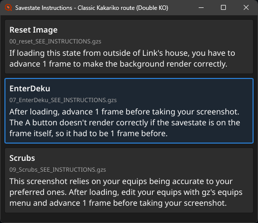

### Without a preset

If there's no preset for your category, take your own screenshots: click Take Screenshot at each split, rename the files in order, like `01_FirstBoss.png`, and erase what changes from run to run in an image editor. [MANUAL.md](MANUAL.md#split-image-file-names) explains file names and masks. You can also make a preset yourself, see [Editing presets](MANUAL.md#editing-presets).

## 5. Check your split images

Before your first run, check that each image matches when it should. File > Live Tester compares one image with the capture, without a run. For split images made from a preset's screenshots, checking the first few tells you whether your capture's picture matches the console's.

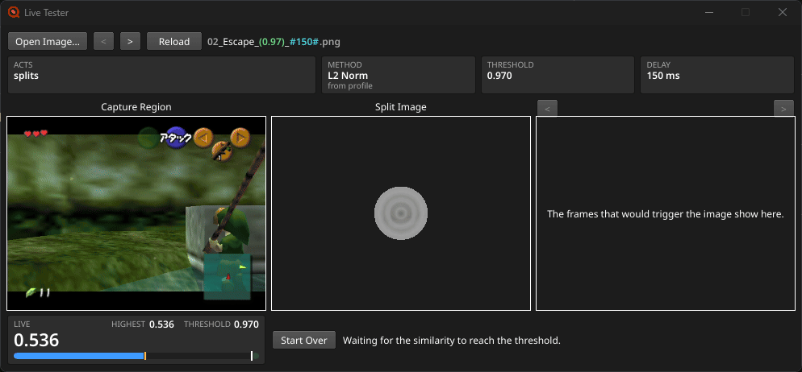

1. Open File > Live Tester. It shows the first image of your split image folder. Use `<` and `>` beside Open Image... for the others.
2. Get to that split's screen in the game.
3. Watch the bar: when it reaches the black line, the threshold, the image matches, and the frame it matched on appears on the right.

If an image never matches, see [Troubleshooting](#troubleshooting).

## 6. Connect your timer

Pick one:

### LiveSplit (Windows)

LiveSplit starts AutoSplit-rs itself and tells it about every start, split and reset.

1. Download `LiveSplit.AutoSplitIntegration.dll` from the [AutoSplit Integration releases](https://github.com/Toufool/LiveSplit.AutoSplitIntegration/releases/latest).
2. Close LiveSplit, put the file in LiveSplit's `Components` folder, and start LiveSplit again.
3. Right-click LiveSplit, choose Edit Layout..., click +, and add AutoSplit Integration from the Control category.
4. Open Layout Settings, and on the AutoSplit Integration tab, choose `AutoSplit.exe` and your profile.

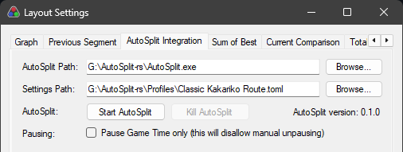

From now on, LiveSplit opens AutoSplit-rs with your layout. Close the AutoSplit-rs you started yourself, so only LiveSplit's is running.

#### A layout for each category

The layout keeps the AutoSplit Integration's settings, so it decides which profile, and so which split images, AutoSplit-rs uses. If you run more than one category, make a layout for each, and let each category's splits load its layout:

1. With the layout set up for one category, right-click LiveSplit and choose Save Layout As..., and name it after the category, like `OoT Any%.lsl`.
2. For each other category, choose its profile in Layout Settings as above, and Save Layout As... again under that category's name.
3. Open a category's splits, right-click LiveSplit and choose Edit Splits.... Turn on Use Layout, and pick the category's layout from the list beside it, or find it with Browse. Then Save Splits. Do the same for each category.

Now opening a category's splits also opens its layout, and LiveSplit starts AutoSplit-rs again with that category's profile, so switching categories in LiveSplit switches the split images too.

### LiveSplit One

Works on Windows, macOS and Linux, with no hotkeys or permissions.

1. In AutoSplit-rs, open File > Settings > Other and choose LiveSplit One (WebSocket) as the timer.
2. In [LiveSplit One](https://one.livesplit.org), choose Connect to Server from its menu and enter `ws://localhost:16835`.

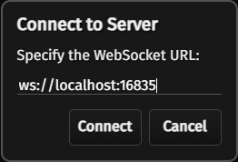

LiveSplit One doesn't reconnect by itself, so connect again each time you start AutoSplit-rs.

### Another timer

AutoSplit-rs presses your timer's hotkeys. Set the same split, reset, undo, skip and pause keys in File > Settings > Hotkeys as in your timer, and turn on global hotkeys in the timer. On Linux, [Molok](MANUAL.md#molok-linux) can be controlled directly.

Whichever timer you use, it needs a segment for each split you chose, apart from dummies, which compare without splitting.

## 7. Do a run

1. Save your profile with File > Save Profile, if you changed anything since Generate Profile.
2. Click Start Auto Splitter, or start your timer. With LiveSplit or LiveSplit One, starting the timer starts AutoSplit-rs too.
3. Play. Current Image shows the split image being compared, and the similarity viewer below the Capture Region how close the capture is to it.

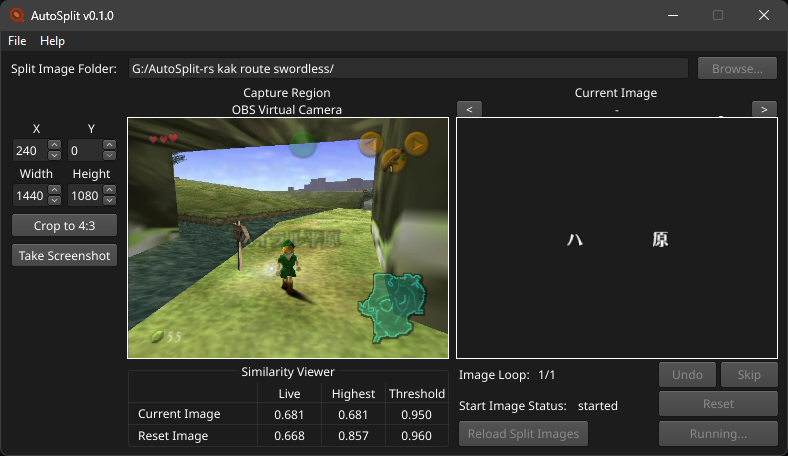

Next time, start AutoSplit-rs (or LiveSplit), start the Virtual Camera in OBS, and run. The profile remembers everything else. If there's exactly one profile next to the program, it's loaded at start, otherwise use File > Load Profile.

## Troubleshooting

Help > View Log says what AutoSplit-rs did and why, like why it didn't split. Start there.

**The Capture Region is gray, or says OBS Virtual Camera isn't started.** Start the Virtual Camera in OBS.

**The game is smaller than the size set in Scaling/Aspect Ratio.** Scaling/Aspect Ratio is above Crop/Pad in the source's filters. Drag it below Crop/Pad, see [An analog capture](#an-analog-capture).

**OBS Virtual Camera isn't in the device list.** Start the Virtual Camera, then press Refresh in Settings. On Linux, install v4l2loopback, see [Virtual Camera on Linux](#virtual-camera-on-linux). On macOS, allow the camera for Terminal.

**A split made from a preset's screenshot never matches.** Your capture's picture differs from the console's. Remove any crop, scaling or color correction filters from the capture source in OBS, and check that the capture region covers the whole picture. If it still doesn't match, make that split image from your own capture, as in [Recording the other splits](#recording-the-other-splits).

**It never splits.** Watch the similarity viewer during the split: Live has to reach Threshold.
- Far below: the capture changed since the image was made. Check the capture region, OBS's crop and color filters, and the capture card's settings, then make the image again.
- Just below: lower that split's threshold a little. For a preset's split, turn on Advanced Make Split Images in File > Settings > Other, change it with the pencil button next to the preset in Make Split Images, save the preset and save the image again. Otherwise, change it in the image's file name, like `(0.88)`.

**It splits too early.** Another screen looks similar enough. Raise that split's threshold, the same way, or give the split before it a longer pause, so it isn't compared during the similar screen. [MANUAL.md](MANUAL.md#split-image-file-names) lists every file name option.

**A preset's split misses at its threshold, and splits too early when lowered.** The split's cue isn't distinct enough on your setup, and no threshold fixes that. Tell the preset's maker. For the bundled presets, open an issue on [GitHub](https://github.com/TorjeAmundsen/AutoSplit-rs/issues) or message `torje` on Discord, so they can look for another cue for that split, like another part of the screen or another moment. Say which game, preset and split it is, and what Highest reaches in the Live Tester on the split's screen and on the screen it splits too early on.

**The timer doesn't react, but AutoSplit-rs moves on.** With hotkeys, the keys in Settings > Hotkeys must be the timer's, with the timer's global hotkeys on. On Linux and macOS, check the [permissions](MANUAL.md#permissions). Or use LiveSplit One, which needs no hotkeys.

**It splits twice on one screen.** Give that split a pause, so it stops comparing for a while after splitting.

## Getting help

Stuck anywhere in the setup, or something here doesn't work for you? Message `torje` on Discord, who is happy to help with setting up and anything else, or open an issue on [GitHub](https://github.com/TorjeAmundsen/AutoSplit-rs/issues). Help > View Log shows what AutoSplit-rs did, which helps to send along.
